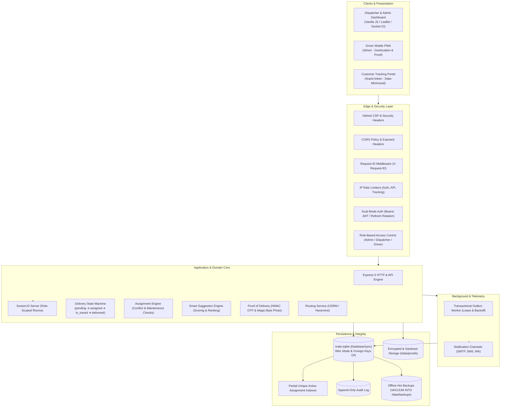

# FleetWise — Real-Time Fleet Management & Delivery Dispatch System

FleetWise is an enterprise-grade, real-time fleet management, vehicle routing, and delivery dispatch platform built with Node.js, Express, `node:sqlite`, and Socket.IO. It guarantees zero double-booking through atomic ACID transactions, isolates operations with granular Role-Based Access Control (RBAC), tracks telematics in real time, and provides cryptographic proof-of-delivery with an offline disaster recovery pipeline.

---

## 1. System Architecture



---

## 2. Features by User Role

### Administrator
- **User & Access Management**: Provision and manage users with role assignments (`admin`, `dispatcher`, `driver`).
- **Fleet Management**: Vehicle CRUD, status transitions, maintenance scheduling, and odometer monitoring.
- **Auditing & Governance**: Complete immutable audit trail (`GET /api/audit-logs`) with caller identity, IP, user agent, and zero PII leakage.
- **Reporting & Business Intelligence**: Executive summary PDF and high-performance streaming CSV reports for delivery performance, driver productivity, and fleet utilization (enforces HTTP 413 on >5,000 rows).
- **Disaster Recovery**: Execution of offline backups (`VACUUM INTO`) and verification of snapshot integrity (`PRAGMA integrity_check`).

### Dispatcher
- **Live Operations Dashboard**: Real-time KPI counters, delivery breakdown, and interactive Leaflet map rendering driver positions.
- **Atomic Assignment**: Assign vehicles and drivers with conflict prevention. Overdue maintenance checks with mandatory reason override logging (`ASSIGNMENT_OVERDUE_OVERRIDE`).
- **Smart Suggestion Engine**: Automated scoring prioritizing vehicle capacity fit, availability, and penalizing overdue maintenance.
- **Customer Contact & Consent**: Manage customer delivery contact details and opt-in consent (`GET/PUT /deliveries/:id/contact`). Pending notifications auto-cancel upon consent revocation.
- **Emergency OTP Regeneration**: Securely regenerate delivery verification codes if a recipient loses their SMS/Email.

### Driver (Mobile PWA at `/driver`)
- **Mobile-First Experience**: Progressive Web App with offline service worker shell caching.
- **Scoped Deliveries**: Strict driver isolation—drivers can only view and update their own assigned orders.
- **Live Telematics**: One-tap background geolocation tracking (`navigator.geolocation`) with manual start/stop controls.
- **Proof of Delivery Submission**:
  - **OTP Verification**: Enter customer's 6-digit OTP verified via server-side HMAC-SHA256 with 5-attempt brute-force lockout.
  - **Photo Proof**: Capture and upload delivery photo with magic byte verification (JPEG/PNG/WebP), EXIF metadata stripping, and 5MB payload limit.

### Customer (Public Tracking at `/track/:token`)
- **Privacy-Preserving Live Tracking**: View order status, estimated delivery time (ETA), and driver location on an interactive map.
- **Data Minimization**: Strict customer privacy protection—full pickup/dropoff street addresses, internal identifiers, and verification OTPs are strictly excluded from public responses.

---

## 3. Technology Stack & Architecture Rationale

| Layer | Component | Rationale |
| :--- | :--- | :--- |
| **Runtime** | Node.js v22.13.0+ or v24+ | Required for native `node:sqlite` (`DatabaseSync`) support without external C++ compilation. |
| **HTTP Framework** | Express v5.3.0 | Modern promise-aware request routing, robust middleware chaining, and HTTP standard compliance. |
| **Database** | `node:sqlite` (`DatabaseSync`) | Zero-dependency, ultra-fast embedded ACID engine with WAL mode and synchronous conflict isolation. |
| **Real-Time** | Socket.IO v4.8+ | WebSocket transport with fallback, room isolation (`ops_room`, driver rooms), and JWT token handshake auth. |
| **Logging** | Pino & Pino-HTTP | High-throughput structured JSON logging with built-in PII and secret redaction. |
| **Security** | Helmet & RateLimit | Strict Content Security Policy (CSP), CORS exposure controls, and IP-based brute-force defenses. |
| **Validation** | Zod | Declarative, schema-based runtime validation for API inputs, environment configs, and coordinate bounds. |

---

## 4. Single-Instance Deployment Guide

> [!WARNING]
> **Single-Instance Deployment Required**:
> FleetWise uses `node:sqlite` with write-ahead logging (WAL), in-memory rate limiting, and local Socket.IO rooms. It **must be deployed as a single instance with a persistent volume** mounted for data persistence. **Do NOT scale to multiple concurrent replica instances**, as SQLite file locks are not network-shareable.

### Deploying to Render
1. Create a **Web Service** connected to your repository.
2. Select **Docker** environment.
3. Attach a **Persistent Disk**:
   - Mount Path: `/data`
   - Size: `1GB` or higher.
4. Configure Environment Variables (see table below). Ensure `DB_PATH=/data/fleetwise.db`, `STORAGE_DIR=/data/proofs`, and `BACKUP_DIR=/data/backups`.
5. Health Check Path: `/health`.

### Deploying to Railway
1. Create a project and deploy from GitHub repository.
2. Under service **Settings**:
   - Add a **Volume**: Mount at `/data`.
3. Under **Variables**, define production secrets.
4. Set Healthcheck Path to `/health`.

### Deploying to Fly.io
1. Create volume: `fly volumes create fleetwise_data --size 1 --region <region>`.
2. Configure `fly.toml`:
   ```toml
   [mounts]
     source = "fleetwise_data"
     destination = "/data"

   [[http_service.checks]]
     grace_period = "10s"
     interval = "30s"
     method = "get"
     path = "/health"
     timeout = "5s"
   ```
3. Deploy: `fly deploy`.

---

## 5. Environment Variables

| Variable | Default | Required in Production? | Description |
| :--- | :--- | :---: | :--- |
| `NODE_ENV` | `development` | Yes | Application mode (`production`, `development`, `test`). |
| `PORT` | `3000` | No | Port on which the HTTP server listens. |
| `DB_PATH` | `./data/fleetwise.db` | No | Absolute or relative path to the SQLite database file. In production, place on persistent disk (`/data/fleetwise.db`). |
| `STORAGE_DIR` | `./storage/proofs` | No | Storage path for photo proofs (`/data/proofs`). |
| `BACKUP_DIR` | `./backups` | No | Storage path for offline backups (`/data/backups`). |
| `JWT_SECRET` | *(Generated test key)* | **Yes** | HMAC key for signing access tokens (min 32 chars, non-placeholder). |
| `JWT_REFRESH_SECRET`| *(Generated test key)* | **Yes** | HMAC key for signing refresh tokens (min 32 chars, distinct from JWT_SECRET). |
| `OTP_HMAC_SECRET` | *(Generated test key)* | **Yes** | HMAC secret for hashing customer OTP codes (min 32 chars, distinct). |
| `JWT_EXPIRES_IN` | `15m` | No | Access token lifespan. |
| `JWT_REFRESH_EXPIRES_IN` | `7d` | No | Refresh token lifespan. |
| `ADMIN_USERNAME` | *(none)* | No | Pre-seeded admin username on cold startup. |
| `ADMIN_PASSWORD` | *(none)* | **Yes** | Pre-seeded admin password (min 12 chars with upper, lower, digit, symbol). |
| `NOTIFICATIONS_ENABLED`| `true` | No | Set to `false` to disable transactional notification worker. |
| `NOTIFICATION_PROVIDER`| `console` (dev) / `smtp` (prod) | Conditional | Provider channel (`smtp`, `console`). Console provider is strictly rejected in production. |
| `SMTP_HOST` | `smtp.example.com` | Conditional | SMTP host server (required if notifications enabled in production). |
| `SMTP_PORT` | `587` | No | SMTP port. |
| `SMTP_USER` | *(none)* | Conditional | SMTP authentication username. |
| `SMTP_PASS` | *(none)* | Conditional | SMTP authentication password. |
| `SMTP_FROM` | `FleetWise <no-reply@...>` | No | Default outbound sender address. |
| `OSRM_URL` | `http://router.project-osrm.org` | No | OpenStreetMap OSRM routing backend endpoint. |
| `LOG_LEVEL` | `info` | No | Pino logging level (`fatal`, `error`, `warn`, `info`, `debug`, `silent`). |
| `CORS_ORIGIN` | `*` | No | Allowed CORS origin header. |

---

## 6. API Documentation

Interactive Swagger / OpenAPI 3.0 documentation is served live at:
```
http://localhost:3000/api/docs
```
It includes schemas, request/response models, and authentication definitions for all vehicle, driver, delivery, tracking, telematics, customer contact, and report endpoints.

---

## 7. Security Architecture

1. **Authentication & Token Rotation**:
   - Access tokens are short-lived (15 minutes) Bearer JWTs stored only in-memory on clients.
   - Refresh tokens are stored as SHA-256 hashes in SQLite and rotated upon every refresh; old tokens are revoked instantly to prevent replay attacks.
2. **Strict Production Enforcement**:
   - Legacy `X-User-Role` headers are ignored outside `NODE_ENV=test`.
   - The server refuses to boot in production if secrets are missing, under 32 characters, identical to each other, or match known placeholder patterns.
3. **Cryptographic Proof of Delivery**:
   - Customer OTPs are never stored in plain text. Stored as HMAC-SHA256 digests.
   - Verification uses `crypto.timingSafeEqual` to eliminate timing side-channel attacks.
   - Five invalid OTP attempts permanently locks verification for that trip.
4. **Photo Proof Hygiene**:
   - Magic byte inspection verifies binary headers (`image/jpeg`, `image/png`, `image/webp`).
   - EXIF metadata is stripped from uploaded JPEG images to remove GPS location leakage and privacy leaks.
   - 5MB strict payload cap; files are immediately deleted if database transactions fail (zero orphan files).
5. **Data Minimization & Public Safety**:
   - Public customer tracking `/track/:token` returns only high-level city/area coordinates and driver position. Full pickup and dropoff street addresses are omitted.
   - Logs redact passwords, tokens, OTPs, recipient emails, and customer names automatically.

---

## 8. Backup & Disaster Recovery (Offline CLI)

FleetWise provides an offline backup and disaster recovery toolchain:

### Creating a Hot Backup
Run hot database snapshotting via SQLite's native `VACUUM INTO`:
```bash
npm run backup
# Or with custom retention days:
node scripts/backup.js --retention-days 14
```
**Process**:
1. Creates an atomic snapshot in `backups/fleetwise-<timestamp>.db`.
2. Executes `PRAGMA integrity_check;` on the backup to guarantee zero corruption.
3. Archives proof photos to `backups/proofs-<timestamp>/`.
4. Saves metadata manifest `backups/fleetwise-<timestamp>-meta.json`.
5. Automatically prunes snapshots older than the retention threshold.

### Restoring from a Backup
Restoration is strictly an offline command-line operation to prevent unauthorized remote invocation:
```bash
# 1. Stop the running server instance
# 2. Run the offline restoration utility:
node scripts/restore.js backups/fleetwise-2026-10-31T12-00-00-000Z.db

# Or with custom target paths:
node scripts/restore.js backups/fleetwise-<timestamp>.db --target-db /data/fleetwise.db --proofs /data/proofs
```
**Process**:
1. Verifies the snapshot integrity using `PRAGMA integrity_check;`.
2. Replaces the target database file atomically and removes stale WAL/SHM artifacts.
3. Restores archived proof files to the storage directory.
4. Displays confirmation; server is now ready for safe startup.

---

## 9. Running Locally & Testing

### Prerequisites
- Node.js `v22.13.0+` or Node.js `v24+`
- npm `v10+`

### Quick Start
```bash
# 1. Clone repository
git clone https://github.com/sandipsahofficial/FleetWise-Vehicle-Delivery-Assignment-System.git
cd FleetWise-Vehicle-Delivery-Assignment-System

# 2. Install dependencies
npm ci

# 3. Copy environment configuration
cp .env.example .env

# 4. Run syntax verification
npm run lint

# 5. Execute full automated test suite
npm test

# 6. Start development server
npm start
```
Access the application:
- **Dispatcher Dashboard**: `http://localhost:3000`
- **Driver Mobile View**: `http://localhost:3000/driver`
- **Interactive API Docs**: `http://localhost:3000/api/docs`
- **Liveness Probe**: `http://localhost:3000/health`
- **Readiness Probe**: `http://localhost:3000/ready`

---

## 10. License

This project is licensed under the MIT License - see the [LICENSE](LICENSE) file for details.
Copyright (c) 2026 **Sandip Sah**.
