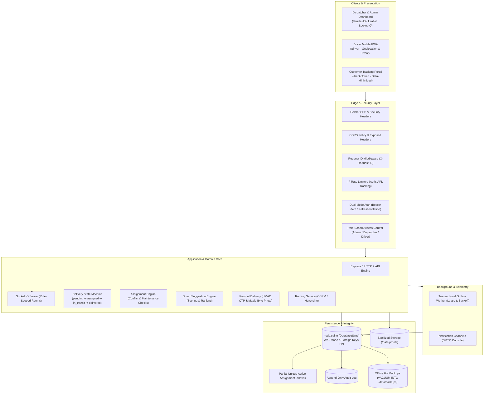

# FleetWise — Real-Time Fleet Management & Delivery Dispatch System

[](https://github.com/sandipsahofficial/FleetWise-Vehicle-Delivery-Assignment-System/actions)
[](LICENSE)
[](https://nodejs.org/)
[](Dockerfile)

FleetWise is an enterprise-grade, real-time fleet management, vehicle routing, and delivery dispatch platform built with Node.js, Express 5, `node:sqlite`, and Socket.IO. It guarantees zero double-booking through atomic ACID transactions, isolates operations with granular Role-Based Access Control (RBAC), tracks telematics in real time, and provides cryptographic proof of delivery with an offline disaster recovery pipeline.

---

## 1. System Architecture



Detailed architecture diagrams, ACID boundaries, and transaction flows are documented in [docs/architecture.md](docs/architecture.md).

---

## 2. Features by User Role

### Administrator
- **User & Access Management**: Provision and manage users with role assignments (`admin`, `dispatcher`, `driver`).
- **Fleet Asset Management**: Complete vehicle lifecycle, status transitions, maintenance scheduling, and odometer monitoring.
- **Auditing & Governance**: Immutable audit trail (`GET /api/audit-logs`) with caller identity, IP, user agent, and zero PII leakage.
- **Reporting & Business Intelligence**: Executive summary PDF and high-performance streaming CSV reports for delivery performance, driver productivity, and fleet utilization (enforces HTTP 413 on >5,000 rows).
- **Disaster Recovery**: Execution of offline backups (`VACUUM INTO`) and verification of snapshot integrity (`PRAGMA integrity_check`).
- **System Health Diagnostics**: Protected `/api/admin/health` endpoint reporting process uptime, memory allocations, and DB connectivity.

### Dispatcher
- **Live Operations Dashboard**: Real-time KPI counters, delivery breakdown, and interactive Leaflet map rendering driver positions.
- **Atomic Assignment**: Assign vehicles and drivers with conflict prevention. Overdue maintenance checks with mandatory reason override logging (`ASSIGNMENT_OVERDUE_OVERRIDE`).
- **Smart Suggestion Engine**: Automated scoring prioritizing vehicle capacity fit, availability, and penalizing overdue maintenance.
- **Customer Contact & GDPR Consent**: Manage customer delivery contact details and opt-in consent (`GET/PUT /deliveries/:id/contact`). Pending notifications auto-cancel upon consent revocation.
- **Emergency OTP Regeneration**: Securely regenerate delivery verification codes if a recipient loses their SMS/Email.

### Driver (Mobile PWA at `/driver`)
- **Mobile-First Experience**: Progressive Web App with offline service worker shell caching.
- **Scoped Deliveries**: Strict driver isolation—drivers can only view and update their own assigned orders.
- **Live Telematics**: One-tap background geolocation tracking (`navigator.geolocation`) with manual start/stop controls.
- **Proof of Delivery Submission**:
  - **OTP Verification**: Enter customer's 6-digit OTP verified via server-side HMAC-SHA256 with 5-attempt brute-force lockout.
  - **Photo Proof**: Capture and upload delivery photo with magic byte verification (JPEG/PNG/WebP), EXIF metadata stripping, and 5MB payload limit.

### Customer (Public Tracking at `/track/:token`)
- **Privacy-Preserving Live Tracking**: View order status, estimated delivery time (ETA), and driver location on an interactive map.
- **Data Minimization**: Strict customer privacy protection—full pickup/dropoff street addresses, internal identifiers, and verification OTPs are strictly excluded from public responses.

---

## 3. Five-Minute Demo Walkthrough

Try the end-to-end workflow in 5 minutes:

1. **Boot Application Locally**:
   ```bash
   cp .env.example .env
   npm run demo:seed
   npm start
   ```
2. **Sign In as Dispatcher**:
   - Open `http://localhost:3000` in your browser.
   - Sign in using credentials generated and logged during demo seeding.
3. **Dispatch a Delivery**:
   - On the Operations Board, locate a `Pending` delivery.
   - Click **Assign** to open the Suggestion Engine. Select recommended vehicle and driver.
   - Observe live status update in real time without refreshing.
4. **Simulate Driver Workflow**:
   - Open `http://localhost:3000/driver` in a mobile viewport or phone browser.
   - Sign in as `driver1`.
   - Tap **Start Trip** (`in_transit`). Tap **Share Location** to stream GPS telematics to the dispatcher map.
5. **Complete Proof of Delivery**:
   - Request customer OTP or take a completion photo.
   - Submit OTP via Driver PWA.
   - Watch the order transition to `Delivered` and vehicle/driver immediately return to the available pool.

---

## 4. Production Deployment & Limitations

### Architecture Limitations & Trade-offs
- **Single-Instance Deployment**: FleetWise uses `node:sqlite` in Write-Ahead Logging (WAL) mode, in-memory rate limiting, and local Socket.IO rooms. It **must be deployed as a single instance with a persistent NVMe volume mounted**. Do not scale horizontally across multiple instances without a shared database adapter (e.g. PostgreSQL) and Redis pub/sub.
- **Residual Risks**: Full STRIDE security analysis and accepted residual risks (in-memory rate limiters, localStorage tokens) are detailed in [docs/threat_model.md](docs/threat_model.md).

### Deploying to Fly.io
Step-by-step instructions for deploying to Fly.io with persistent NVMe volumes and offsite disaster recovery runbooks are in **[docs/deployment-flyio.md](docs/deployment-flyio.md)**.

### Live Smoke Verification
Run the automated end-to-end smoke test against any running environment:
```bash
SMOKE_ADMIN_PASSWORD="YourAdminPassword" node scripts/smoke_test.js --url http://localhost:3000
```

---

## 5. Technology Stack

| Layer | Component | Rationale |
| :--- | :--- | :--- |
| **Runtime** | Node.js v22+ or v24+ | Native `node:sqlite` (`DatabaseSync`) support without external C++ toolchains. |
| **HTTP Framework**| Express v5.3.0 | Modern promise-aware request routing, robust middleware chaining. |
| **Database** | `node:sqlite` (`DatabaseSync`) | Embedded ACID engine with WAL mode and zero-latency in-process queries. |
| **Real-Time** | Socket.IO v4.8+ | WebSocket transport with fallback, room isolation, and JWT handshake auth. |
| **Logging** | Pino & Pino-HTTP | High-throughput structured JSON logging with built-in PII and secret redaction. |
| **Security** | Helmet & RateLimit | Strict Content Security Policy (CSP), CORS controls, and brute-force defenses. |
| **Validation** | Zod | Declarative runtime validation for API inputs, coordinates, and environment variables. |

---

## 6. Complete Documentation Index

- **[System Architecture & Concurrency](docs/architecture.md)**: Deep dive into SQLite WAL concurrency, transactional outbox pattern, and crash lease recovery.
- **[Fly.io Deployment Guide](docs/deployment-flyio.md)**: Step-by-step instructions for persistent volume deployment and restore drills.
- **[RBAC Permissions Matrix](docs/roles_matrix.md)**: Comprehensive endpoint, method, and role entitlement table.
- **[Threat Model & Residual Risks](docs/threat_model.md)**: STRIDE analysis and documentation of accepted trade-offs.
- **[API Reference (Swagger UI)](http://localhost:3000/api/docs)**: Interactive OpenAPI specification.

---

## 7. Testing & Linting

FleetWise maintains a strict 100% deterministic test suite:
```bash
# Verify ESLint code standards (flat config)
npm run lint

# Execute automated tests across Node 22 and 24
npm test
```

---

## 8. License

This project is licensed under the MIT License - see the [LICENSE](LICENSE) file for details.
Copyright (c) 2026 **Sandip Sah**.
