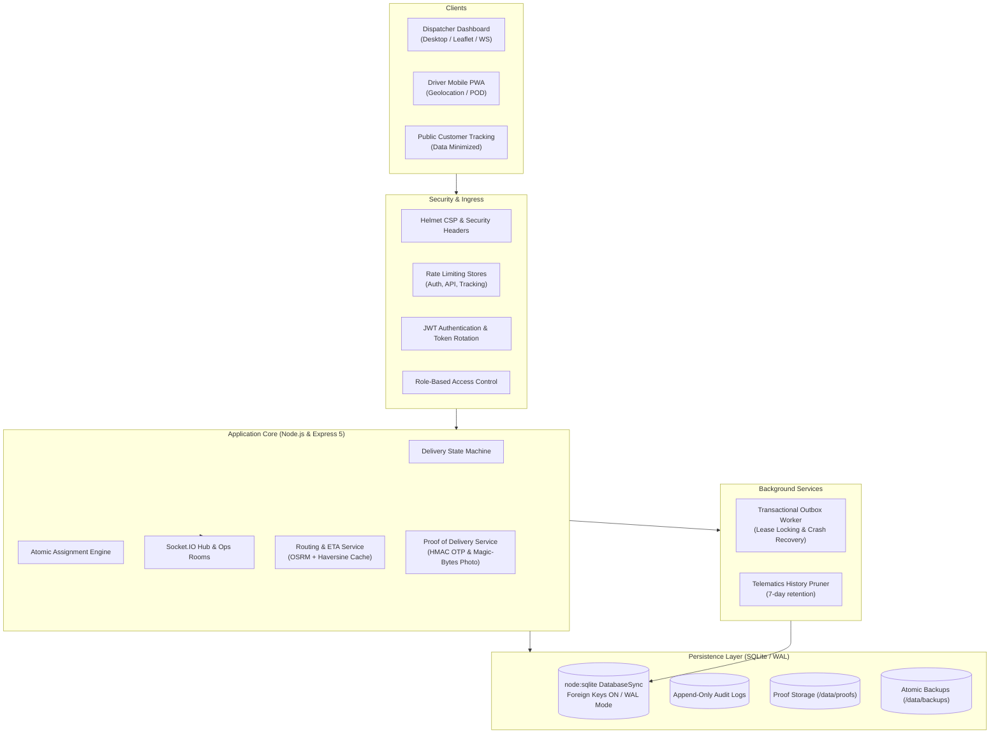
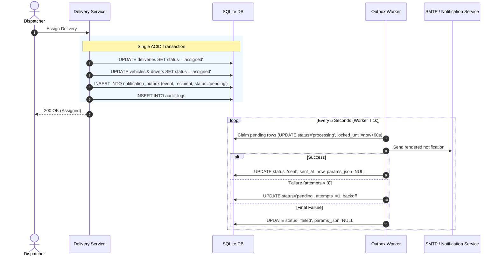
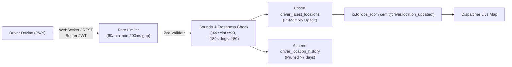

# FleetWise System Architecture

FleetWise is designed as a modular, resilient, single-instance dispatch and telematics platform. This document outlines the core structural components, concurrency models, data flows, and consistency guarantees.

---

## 1. High-Level Topology

---

## 2. Concurrency & ACID Boundaries

### SQLite Write-Ahead Logging (WAL)
FleetWise utilizes Node.js's native `node:sqlite` engine configured with:
- `PRAGMA journal_mode = WAL;` (Concurrent readers do not block writers; writer does not block readers).
- `PRAGMA synchronous = NORMAL;` (Ensures durability while avoiding blocking disk fsync on every commit).
- `PRAGMA foreign_keys = ON;` (Strict referential integrity across vehicles, drivers, deliveries, and audit trails).

### Atomic Resource Assignment
Preventing double-booking requires zero-race-window transactions. The assignment transaction:
1. Validates delivery status is `pending`.
2. Verifies vehicle status is `available` and checks maintenance status.
3. Verifies driver status is `available`.
4. Updates delivery status to `assigned` and sets vehicle and driver references.
5. Updates vehicle status to `assigned` and driver status to `assigned`.
6. Enqueues an outbox event `delivery_assigned` in the **exact same database transaction**.
7. Writes an audit log entry in the **exact same database transaction**.
8. Commits atomically.

If any check fails or concurrent operations attempt to claim the same resource, the transaction rolls back cleanly, leaving zero partial state. Post-commit Socket.IO events fire only after the transaction successfully commits.

---

## 3. Transactional Outbox Pattern

To eliminate distributed 2-phase commits between the database and notification channels (email, SMS), FleetWise implements the Transactional Outbox Pattern:

### Crash Recovery & Lease Management
If a node crashes while processing an outbox row, the `locked_until` lease expires after 60 seconds. On the next tick, stalled rows automatically revert to `pending` status and retry.

---

## 4. Telematics & Live Location Pipeline

Drivers stream GPS coordinates via WebSocket (`driver:location_update`) with fallback to REST (`POST /drivers/:id/location`).

### Rate Limiting & Scope Isolation
- Keyed by `targetDriverId` or `userId`.
- Cleaned up from memory when socket disconnects.
- Driver accounts may only submit telematics for their own linked driver record.

